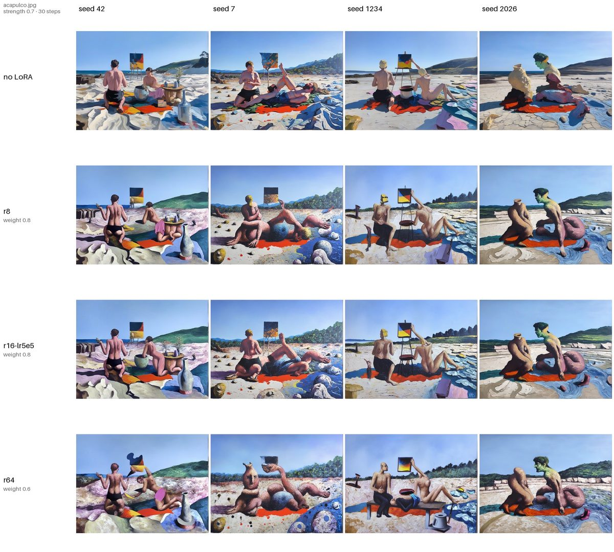
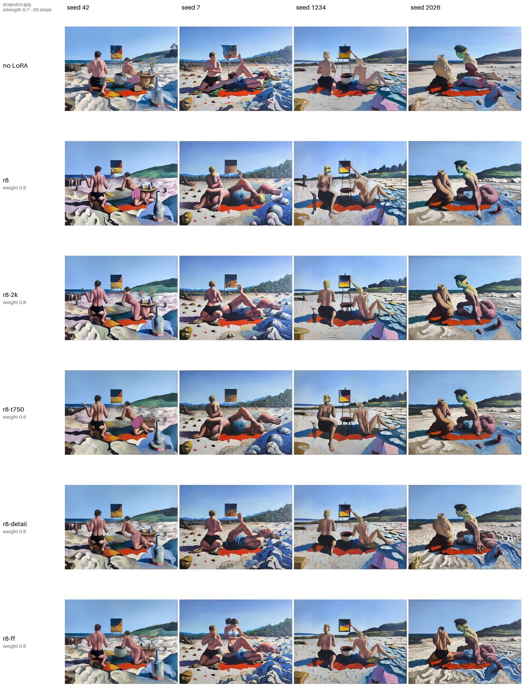

# Neuroitburd

Neuroitburd turns photos into paintings. It runs SDXL image-to-image with a style LoRA that
you train on your own corpus of paintings: an artist's body of work, a period, a school, or
your own canvases. It includes:

- a training toolkit: dataset preparation, a LoRA trainer that fits a 12 GB GPU, and a fair
  evaluation grid for comparing runs
- a CLI for single images
- a web app: a React UI and a FastAPI backend with a single-GPU job queue

The project started as an experiment with the paintings of Oleksandr Roitburd, which
remain the reference case study (see [Case study](#case-study-oleksandr-roitburd)).
Without a LoRA it uses base SDXL with a style prompt.

```
photo --> image_utils (validate, fit to ~1 MP) --> pipeline (SDXL img2img + LoRA) --> PNG
              ^                                        ^
            cli.py                       jobs.py (FIFO queue, one worker thread)
                                                       ^
                                   api.py (FastAPI) <-- frontend/ (React, Vite)
```

## Requirements

| | Requirement |
|---|---|
| OS | Linux (tested on Ubuntu 25.10) |
| GPU | NVIDIA with 10 GB+ free VRAM (tested: RTX 4070 SUPER, 12 GB). Less works with `NEUROITBURD_OFFLOAD=model`; CPU-only takes minutes per image |
| Driver | NVIDIA 580+ for the default PyPI torch wheel (CUDA 13.2) |
| Python | 3.11+ (tested on 3.13.7) |
| Node | 20.19+ for the web interface |
| Disk | about 7 GB for the SDXL weights, several GB for the Python ML stack |

On first use the SDXL base weights (fp16) and the `madebyollin/sdxl-vae-fp16-fix` VAE are
downloaded into the Hugging Face cache (`~/.cache/huggingface` or `$HF_HOME`). Installation
and the automated tests download nothing.

## Installation

```bash
git clone <repo-url> neuroitburd && cd neuroitburd
python3 -m venv .venv
.venv/bin/pip install -r requirements.txt          # backend + CUDA PyTorch + diffusers + dev tools
.venv/bin/python -c "import torch; print(torch.cuda.is_available())"   # should print True
cd frontend && npm install                         # web interface
```

- The PyPI torch wheel ships its own CUDA runtime. With a driver older than 580, first run
  `.venv/bin/pip install torch --index-url https://download.pytorch.org/whl/cu128`.
- `.venv/bin/pip install -e ".[dev]"` is a lightweight install without torch. It is enough
  for the tests, the fake pipeline and UI work.
- A transformers warning that torchvision is missing is harmless.
- After the first download, `export HF_HUB_OFFLINE=1` keeps later runs offline.

## Quick start

```bash
make start LORA=none           # base SDXL; UI on http://127.0.0.1:5173; FAKE=1 runs without a GPU
make start LORA=models/loras/my-style/my-style.safetensors TRIGGER="mystyle painting"
make status                    # running? model loading or ready?
make logs                      # follow both logs
make stop
```

Open the UI, drop an image, adjust strength, steps and seed (guidance and prompts are
under "Advanced"), press Generate and download the PNG. `make start` adds the LoRA's
trigger phrase (`TRIGGER`) to the default prompt. Without `LORA=` it loads the case-study
LoRA (`models/loras/r8-2k`), which is not distributed. `make help` lists every target and
variable.

## CLI

```bash
.venv/bin/python -m neuroitburd.cli --input examples/acapulco.jpg --output outputs/result.png \
  --strength 0.65 --steps 30 --guidance 7.0 --seed 42 \
  --lora models/loras/my-style/my-style.safetensors --lora-weight 0.8 \
  --prompt "my trigger, an expressive oil painting"
```

| Option | Default | Meaning |
|---|---|---|
| `--input`, `--output` | required | JPEG/PNG/WebP in; `.png`, `.jpg` or `.webp` out |
| `--strength` | 0.65 | 0 to 1: how far to move away from the photo |
| `--steps` | 30 | 1 to 100; img2img runs `steps * strength` steps |
| `--guidance` | 7.0 | 0 to 20: how strictly to follow the prompt |
| `--seed` | random | printed when omitted, so every result is reproducible |
| `--prompt`, `--negative-prompt` | configured defaults | max 500 characters |
| `--lora`, `--lora-weight` | from settings | SDXL LoRA file and its strength |
| `--device`, `--offload` | from settings | see Configuration |

Images are resized to about 1 megapixel with the aspect ratio kept (a 4000x3000 photo
becomes 1176x880). Inputs are validated before the model loads. Exit codes: 0 ok,
1 unexpected, 2 bad input, 3 model/device/LoRA error, 4 generation or out-of-memory error.
`make stylize IMG=photo.jpg` is a shortcut.

## Web app and API

To run without make, use two terminals:

```bash
.venv/bin/uvicorn neuroitburd.api:app --host 127.0.0.1 --port 8000   # model loads in 10-60 s
cd frontend && npm run dev                                           # http://127.0.0.1:5173
```

Run exactly one backend process. The model is loaded once, and a FIFO queue runs one
generation at a time. `--workers N` would load a separate 8 GB copy per worker, and
`--reload` would reload the model on every code change. There is no authentication, so
keep the backend on `127.0.0.1`.

| Method | Path | Result |
|---|---|---|
| GET | `/api/health` | status, model state, device, LoRA, GPU, queue size |
| POST | `/api/generate` | multipart `image` plus optional `strength`, `steps`, `guidance`, `seed`, `prompt`, `negative_prompt`; returns 202 with `job_id` |
| GET | `/api/jobs/{job_id}` | `status`, `progress`, `error`, `output_url`, `params` |
| GET | `/api/images/{image_id}` | the generated PNG |

Errors are JSON `{"detail": "..."}` with status 422 (invalid input), 413 (too large),
415 (not an image), 404 (unknown id) or 503 (queue full or model unavailable).

## Configuration

All settings are environment variables:

| Variable | Default | Meaning |
|---|---|---|
| `NEUROITBURD_MODEL_ID` | `stabilityai/stable-diffusion-xl-base-1.0` | Base model (Hub id or local folder) |
| `NEUROITBURD_VAE_ID` | `madebyollin/sdxl-vae-fp16-fix` | VAE override; empty uses the model's own |
| `NEUROITBURD_DEVICE` | `auto` | `auto`, `cuda` or `cpu`; `cuda` never falls back to CPU |
| `NEUROITBURD_OFFLOAD` | `none` | `model` offloads to CPU: less VRAM, slower |
| `NEUROITBURD_LORA_PATH` | empty | SDXL LoRA `.safetensors` file |
| `NEUROITBURD_LORA_WEIGHT` | `0.8` | LoRA strength, 0 to 2 |
| `NEUROITBURD_DEFAULT_PROMPT` | expressive postmodern oil painting... | Prompt when a request has none |
| `NEUROITBURD_DEFAULT_NEGATIVE_PROMPT` | photo, photorealistic, blurry... | Negative prompt when a request has none |
| `NEUROITBURD_OUTPUT_DIR` | `outputs` | Results and uploads |
| `NEUROITBURD_MAX_UPLOAD_MB` | `20` | API upload limit |
| `NEUROITBURD_MAX_QUEUE_SIZE` | `20` | Waiting jobs; more get HTTP 503 |
| `NEUROITBURD_FAKE_PIPELINE` | `0` | `1` replaces SDXL with a cheap filter (no GPU, no torch) |
| `NEUROITBURD_LOG_LEVEL` | `INFO` | Python logging level |

Any LoRA trained for SDXL 1.0 base works, including kohya/A1111 exports. A LoRA for another
base model either fails to load or has no visible effect (check the backend log for
unmatched keys). Typical weights are 0.6 to 1.0. If the LoRA uses a trigger phrase, put it
in the prompt.

## Training a style LoRA on your own corpus

The trainer works with any folder of images in a consistent style. Use 30 to 200
paintings, as large and sharp as you have, with no frames, watermarks or photos of rooms.

**1. Prepare the dataset.** Each image is trimmed, fitted to about 1 MP and captioned
`"<trigger>, <title>"`. The title comes from the file name, so descriptive names help. Pick
a trigger phrase that is not a real word, so it means only your style.

```bash
make prepare SRC=~/paintings/my-artist DATA=data/my-artist TRIGGER="mystyle painting"
make crops   SRC=~/paintings/my-artist CROPS=data/my-artist-detail TRIGGER="mystyle painting"   # optional
```

`make crops` cuts native-resolution 1024x1024 detail crops from large, sharp sources. They
teach brushwork and texture and make up at most half of the dataset.

**2. Train.** The default recipe is rank 8 on the attention layers, 2000 steps, AdamW at
1e-4 with warmup and cosine decay, min-SNR gamma 5 and 5% caption dropout. It takes about
17 minutes on an RTX 4070 SUPER.

```bash
make stop    # training needs the GPU that the web app holds
make train NAME=my-artist DATA=data/my-artist
make train NAME=my-artist-detail DATA=data/my-artist EXTRA_DATA=data/my-artist-detail
```

| Option | Default | Effect |
|---|---|---|
| `RANK`, `LR`, `STEPS` | 8, 1e-4, 2000 | capacity, learning rate, length |
| `MAX_T` | 1000 | `750` trains only the noise levels img2img uses |
| `NOISE_OFFSET` | 0 | `0.05` helps with very dark or very light paintings |
| `TARGETS` | `attn` | `attn-ff` or `attn-ff-conv` also trains feed-forward and conv layers |
| `EXTRA_DATA` | empty | more dataset folders, e.g. the detail crops |

Results go to `models/loras/<NAME>/`: the final LoRA, a checkpoint every 1000 steps
(`SAVE_EVERY`), the settings and the loss log. `make train` refuses to overwrite an
existing run unless `FORCE=1`.

**3. Evaluate.** The seed changes the picture more than the LoRA does, so compare runs on
the same photos and seeds:

```bash
make eval NAME=my-artist TRIGGER="mystyle painting" \
  EVAL_MODELS="none models/loras/my-artist/my-artist.safetensors models/loras/my-artist-detail/my-artist-detail.safetensors"
make compare NAME=my-artist        # the run's checkpoints x weights on one photo
```

`make eval` renders every model in `EVAL_MODELS` (`none`, `path` or `path@weight`) on two
photos x 4 seeds into `outputs/eval/<NAME>/`.

**4. Use it.** Run `make start LORA=models/loras/my-artist/my-artist.safetensors TRIGGER="mystyle painting"`,
or pass the file to the CLI with `--lora`.

## Case study: Oleksandr Roitburd

We trained on 175 Roitburd paintings, plus 62 detail crops in some runs, with the trigger
`rtbrd style painting`. The paintings are copyrighted, so the dataset and the LoRA files
are not part of this repository. All grids show `examples/acapulco.jpg` at strength 0.7,
30 steps, LoRA weight 0.8 (0.6 for r64) and seeds 42, 7, 1234 and 2026.

### Sweep 1: rank and steps (2026-11-23)

| Run | Rank / alpha | LR | Steps | Result |
|---|---|---|---|---|
| no LoRA | | | | base SDXL with the style prompt |
| r8 | 8 / 8 | 1e-4 | 4000 | clear Roitburd look |
| r16-lr5e5 | 16 / 16 | 5e-5 | 3000 | almost the same as r8 |
| r64 | 64 / 32 | 1e-4 | 4000 | overfits: invents objects, loses the composition |



Rank barely matters between 8 and 32, so rank 8 gives the same result at a quarter of the
file size.

### Sweep 2: training options (2026-11-24)

All runs are rank 8 with 2000 steps.

| Run | Data | `MAX_T` | `NOISE_OFFSET` | `TARGETS` | Result |
|---|---|---|---|---|---|
| r8 (sweep 1) | paintings | 1000 | 0 | attn | reference, 4000 steps |
| r8-2k | paintings | 1000 | 0 | attn | strongest Roitburd character |
| r8-t750 | paintings | 750 | 0.05 | attn | drops the learned signature, still undresses people |
| r8-detail | + detail crops | 750 | 0.05 | attn | best balance: keeps clothing in 3 of 4 seeds, richer texture |
| r8-ff | + detail crops | 750 | 0.05 | attn-ff-conv | most faithful to the photo, mildest style |



We judged the runs by how much of the artist's character the results have, not by how
faithful they stay to the photo. By that measure r8-2k is best and r8-t750 second, so
r8-2k's settings are the `make train` defaults and r8-2k is the `make start` default. If you care more about faithfulness to the photo, try r8-detail or r8-ff.

## Performance

Measured on an RTX 4070 SUPER (12 GB) in fp16 with the whole pipeline on CUDA and no LoRA
(2026-11-21). Reproduce it with `HF_HUB_OFFLINE=1 .venv/bin/pytest -m gpu -s`.

| Metric | Value |
|---|---|
| Model load from the local cache | 10.7 s |
| Generation, 1176x880, 30 steps at strength 0.65 | 5.6 to 6.2 s |
| Peak VRAM allocated by PyTorch | 8.05 GiB |
| Total GPU memory in use, including the desktop | up to 11.5 of 11.6 GiB |

## Limitations

- **Style, not reproduction.** A LoRA moves the output towards a style; it does not repaint
  the photo the way the artist would. Flat, graphic images change little; for photos use
  strength 0.65 to 0.8.
- **GPU memory.** The 12 GB card is nearly full during generation. If a job fails with
  "GPU ran out of memory", close other GPU apps or set `NEUROITBURD_OFFLOAD=model`. Only
  that job fails; the server keeps running.
- **Output size** is about 1 MP. Inputs must be 64 to 8192 px per side, aspect ratio at
  most 4:1, at most 20 MB in the API.
- **Local use only.** One process and one GPU, no authentication. Jobs live in memory and
  cannot be cancelled, and `outputs/` is never cleaned automatically.
- **Copyright.** Training on an artist's work does not give you rights to it. Check the
  license before you share a dataset or a LoRA trained on it.

## Development

```bash
.venv/bin/pip install -e ".[dev]"   # no torch needed
make check                          # pytest (no GPU, no downloads), ruff, mypy
cd frontend && npx tsc --noEmit && npm run build
```

`AGENTS.md` describes the working agreement and module boundaries.
`IMPLEMENTATION_PLAN.md` describes the milestones and design decisions.
